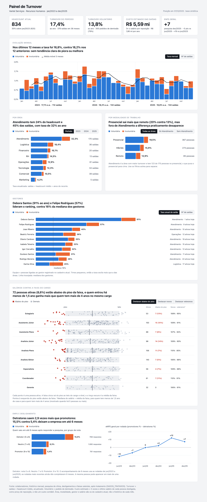
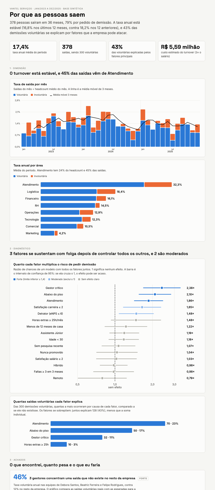

# Diagnóstico de turnover (RH)

Análise de dados de RH de uma empresa fictícia (Vantel Serviços): por que as pessoas saem, quanto cada causa pesa e o que fazer. O projeto vai da limpeza de dados brutos e inconsistentes até um **dashboard para a diretoria** e um **relatório de diagnóstico**, tudo gerado por um pipeline que se roda de novo a cada trimestre com um comando.

> Os dados são **sintéticos**. A empresa, as pessoas, os salários e as avaliações não existem.

**Veja o resultado online** (GitHub Pages):

- [Dashboard de turnover](https://ricardopjm.github.io/analise-turnover-rh/dashboard_turnover.html)
- [Relatório de diagnóstico](https://ricardopjm.github.io/analise-turnover-rh/relatorio_turnover.html)

[](https://ricardopjm.github.io/analise-turnover-rh/dashboard_turnover.html)

## O que a análise encontrou

Base: jan/2023 a dez/2025, 1.212 pessoas, 378 desligamentos (300 pedidos de demissão).

| | |
|---|---|
| Turnover anual | **17,4%**, estável: 16,8% nos últimos 12 meses contra 18,2% nos 12 anteriores |
| Custo estimado das saídas | **R$ 5,59 milhões** (3× o salário por reposição, uma premissa) |
| Onde concentra | **Atendimento**: 24% do headcount e 45% das saídas, 32% de turnover ao ano |
| Fatores que se sustentam | gestor crítico (2,4×), salário abaixo do piso (2,1×) e Atendimento (1,9×) com folga; satisfação com a carreira (1,65×) e eNPS baixo (1,5×) moderados |
| Peso | os fatores principais explicam **128 das 300** demissões voluntárias (43%) |

Três achados que valem destaque:

1. **Três gestores concentram uma saída que não existe no resto da empresa.** Nas equipes deles a taxa é de 46% ao ano contra 12%, e todas as saídas com motivo "Relação com a gestão" estão nessas equipes.
2. **Quem está abaixo do piso da faixa sai 2,2 vezes mais** (25% contra 11% ao ano), e o padrão se repete em todos os anos. Mas corrigir o piso das 72 pessoas afetadas custa mais do que o turnover evitado, então a justificativa é equidade e não economia.
3. **A diferença de turnover entre presencial e remoto vem da área, não da modalidade.** Fora de Atendimento, as três modalidades ficam entre 12% e 13%.

O relatório também diz o que é **fraco ou pode ser coincidência**: horas extras, faltas, idade e tempo de casa não têm efeito claro depois de controlar os demais fatores.

[](https://ricardopjm.github.io/analise-turnover-rh/relatorio_turnover.html)

## O que este projeto demonstra

- **Tratamento de dados reprodutível.** 20 tipos de inconsistência corrigidos por regra, cada um registrado em log (datas em dois formatos, salário em texto, categorias com várias grafias, duplicatas, registros órfãos, valores impossíveis), com decisões documentadas.
- **Método estatístico explicado.** Painel pessoa-mês em que cada fator só usa informação anterior à saída, regressão logística escrita em Python puro e classificação dos fatores por intervalo de confiança.
- **Honestidade sobre o que a base prova.** Cada achado traz número, peso e ação, e o que é associação fica separado do que seria causa.
- **Dashboard e relatório em HTML único**, sem dependências: gráficos em SVG desenhados à mão, filtros, tooltips e tema claro e escuro.
- **Pipeline que se roda de novo.** Nada de ano, data, área ou gestor fixo no código. Um comando confere os dados, gera tudo, arquiva a entrega e compara com o trimestre anterior.

## Como reproduzir

Requisitos: **Python 3.9 ou superior**, sem nenhuma biblioteca externa. Chrome é opcional, só para conferir os HTMLs.

```bash
git clone https://github.com/ricardopjm/analise-turnover-rh.git
cd analise-turnover-rh
python3 -I src/rodar_diagnostico.py
```

O script confere os dados brutos em `DADOS/`, trata, calcula, gera os dois HTMLs e arquiva a entrega em `ENTREGAS/<período>/`, com um `comparativo.md` contra o trimestre anterior. Para abrir, dê dois cliques nos arquivos `.html`.

### Uso a cada trimestre

1. Substitua os 5 CSVs em `DADOS/` pelos novos, mantendo o histórico completo desde jan/2023.
2. Rode `python3 -I src/rodar_diagnostico.py`.
3. Leia `ENTREGAS/<período>/comparativo.md`: ele mostra a variação dos indicadores e o que mudou de qualitativo (área crítica, gestores críticos, fatores que mudaram de classificação).

Se um arquivo vier com colunas diferentes, categoria nova ou datas inconsistentes, o pipeline **para antes de arquivar** e explica o motivo, em vez de adivinhar. O [CLAUDE.md](CLAUDE.md) documenta o fluxo completo, as regras e o que exige julgamento humano a cada rodada.

## Como funciona

```
DADOS/ (CSVs brutos)
   │  rodar_diagnostico.py confere as colunas e a consistência
   ▼
limpeza_rh.py ──► DADOS_TRATADOS/  +  log_limpeza.csv, rejeitados.csv
   ▼
turnover.py        headcount e saídas por mês, tipo, área e modalidade
salario_faixa.py   inversão salarial, posição na faixa, lista abaixo do piso
base_analitica.py  painel pessoa-mês  ──►  modelo.py (regressão logística)
   ▼
dados_relatorio.py ► gerar_relatorio.py  ──►  relatorio_turnover.html
dados_dashboard.py ► gerar_dashboard.py  ──►  dashboard_turnover.html
   ▼
ENTREGAS/<período>/  (HTMLs, listas, logs, resumo.json, comparativo.md)  +  docs/ (GitHub Pages)
```

### Decisões de método

- **Turnover** = saídas ÷ headcount médio, anualizado pelo número de meses do recorte. Voluntário = pedido de demissão.
- **Custo estimado** = 3× o último salário de cada pessoa desligada. É uma premissa de reposição, nunca custo contábil.
- **Gestor crítico**: saídas voluntárias pelo menos 1,5× o esperado para a área e chance de acaso (Poisson) menor que 5%. A lista é calculada a cada execução, não digitada.
- **Classificação dos fatores**: no modelo com todos os fatores juntos, **forte** se o limite inferior do intervalo de confiança de 95% da razão de chances é ≥ 1,4, **moderado** se o intervalo exclui 1, **sem efeito claro** se cruza o 1.
- **Fatores medidos antes da saída**: horas extras e faltas dos 3 meses anteriores, eNPS da pesquisa mais recente (até 200 dias antes).
- **Tendência**: últimos 12 meses contra os 12 anteriores. Diferença abaixo de 1,5 ponto percentual é "estável".

## Estrutura do repositório

```
DADOS/              CSVs brutos sintéticos (entrada)
src/                pipeline em Python (biblioteca padrão) e templates dos HTMLs
src/utilitarios/    ferramenta para simular um trimestre anterior (testes)
ENTREGAS/2025-T4/   entrega de exemplo: dashboard, relatório, listas, logs, resumo
docs/               páginas do GitHub Pages, dicionário de dados e imagens do README
CLAUDE.md           documentação operacional do fluxo (arquivos, regras, análises, entregáveis)
```

`DADOS_TRATADOS/` e `RESULTADOS/` são regerados a cada execução e ficam fora do repositório.

## Limitações

- Associação, não causa. O motivo de saída é declarado pelo colaborador, e o eNPS pode refletir uma decisão já tomada.
- Área, modalidade, gestor e salário são os do cadastro atual, não o histórico de cada mês.
- A pesquisa de clima cobre cerca de 72% das pessoas.
- Cerca de 57% das demissões voluntárias não têm explicação nesta base (motivos pessoais, mudança de cidade, proposta de outra empresa).

## Sobre o desenvolvimento

Projeto desenvolvido com apoio do [Claude Code](https://claude.com/claude-code). O `CLAUDE.md` registra o fluxo para que a análise seja reexecutada de forma consistente.

## Licença

[MIT](LICENSE)
